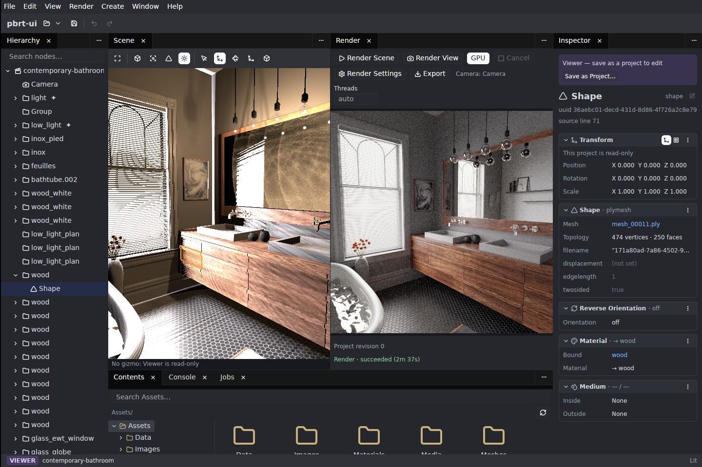
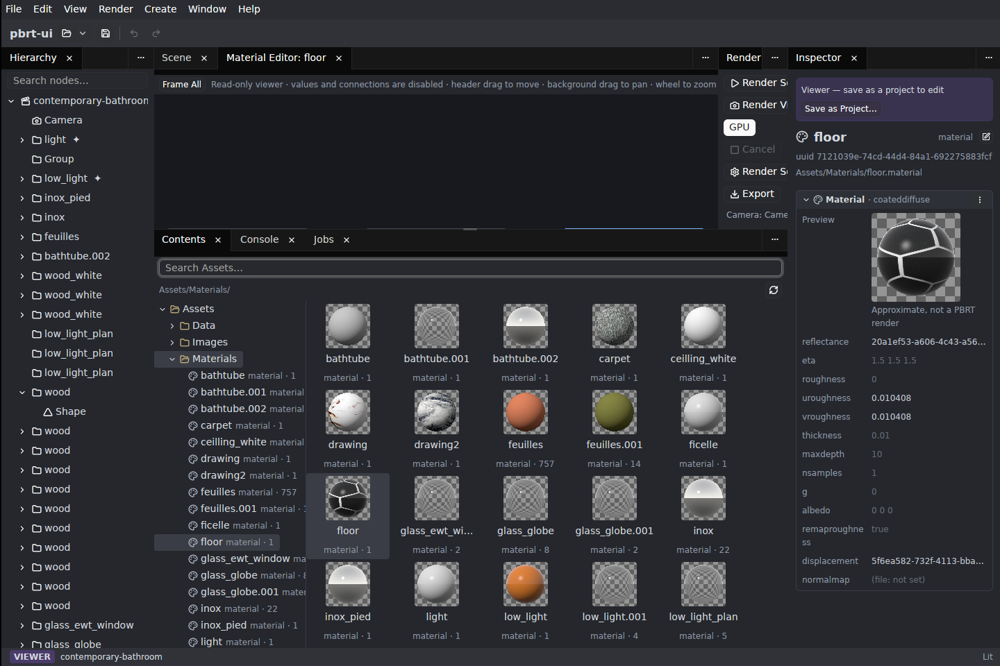
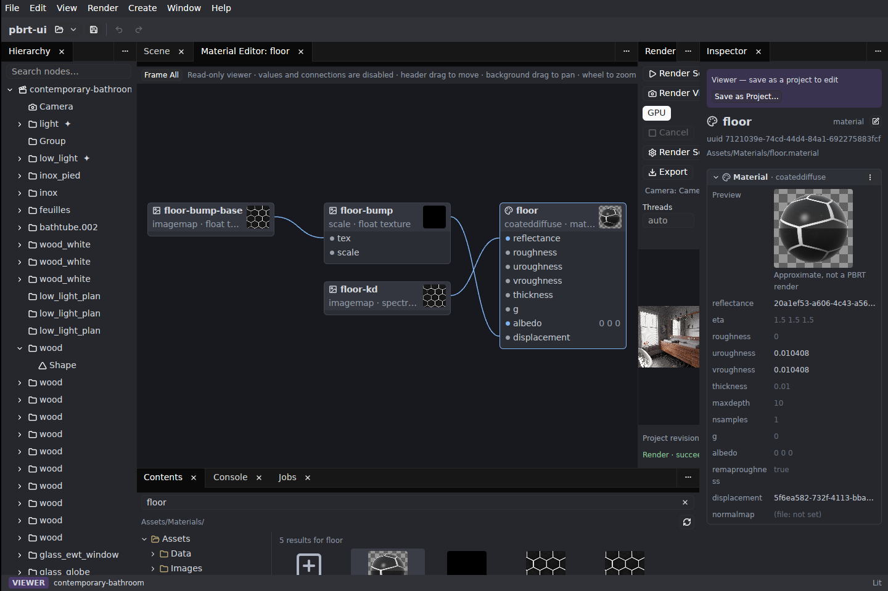

# pbrt-ui

A scene editor for [PBRT v4](https://pbrt.org/) scenes. Open a `.pbrt` file, look at it in a
real-time viewport, edit objects, lights and materials, and render the final image with
[pbrt-r4](https://crates.io/crates/pbrt-r4).



The screenshots show the Contemporary Bathroom scene from
[pbrt-v4-scenes](https://github.com/mmp/pbrt-v4-scenes). The model is by Mareck, via
[Blend Swap](https://www.blendswap.com/blend/13303), and is in the public domain (CC0).

- **Viewer and projects.** A `.pbrt` file opens as a read-only Viewer. Save it as a project
  folder to edit it. Your source files are never overwritten.
- **Unity-style editor.** It has a Hierarchy (scene graph), a Scene viewport, an Inspector
  (transform, shape, light, material and medium parameters), Contents (the project's assets)
  and a Render panel. Panels can be docked, split and combined.
- **Preview and render.** The viewport shows Solid, Normal, Wireframe and Lit previews. Render
  Scene and Render View run pbrt-r4 in the background, with live intermediate images.
- **Undo and redo** cover every edit, import, move, rename and delete.
- **Export** the project back to a `.pbrt` scene, in a folder with every file it needs.
- **Automation.** A command-line tool (`pbrt-ui-ctl`) and an MCP server (`pbrt-ui-mcp`) control
  the running app, so scripts and AI agents can edit and render too.

## Install

pbrt-ui runs on Linux, macOS (Apple Silicon) and Windows 10 1803+ / 11. The release folder holds
these programs:

| Program | What it is |
|---|---|
| `pbrt-ui` | The editor |
| `pbrt-r4` | The renderer, when the release bundles it |
| `pbrt-ui-host` | The same core without a window |
| `pbrt-ui-ctl` | The command-line tool |
| `pbrt-ui-mcp` | The MCP server |
| `pbrt-ui-capture` | The preview helper |

Keep the programs together in one folder.

To build the release folder yourself, install [Rust](https://rustup.rs/) and the platform
requirements below. Then run this in this repository:

```sh
cargo xtask dist --bundle-r4 /path/to/output
```

`--bundle-r4` also builds pbrt-r4 and puts it beside `pbrt-ui`, with its license. To use a
pbrt-r4 you already have instead, pass its path:
`cargo xtask dist /path/to/output /path/to/pbrt-r4`.

Platform requirements:

- **Linux:** a Vulkan driver, plus these packages to build:

  ```sh
  sudo apt install libwayland-dev libxkbcommon-dev libxkbcommon-x11-dev \
    libx11-xcb-dev libegl1-mesa-dev libgl1-mesa-dev libvulkan-dev libasound2-dev \
    libfontconfig-dev pkg-config
  ```

- **macOS:** the Xcode Command Line Tools (`xcode-select --install`).
- **Windows:** Visual Studio 2022 17.10 or later, with "Desktop development with C++" and the
  "C++ ATL" component.

### Linux application menu

The Linux release folder includes `install-desktop-entry.sh`. It adds pbrt-ui, with its icon,
to your application menu (for your user only):

```sh
./install-desktop-entry.sh              # add the menu entry
./install-desktop-entry.sh --uninstall  # remove it
```

The entry points at the folder, so run the script again if you move the folder. A folder path
that contains `%` is not supported.

## Getting started

```sh
pbrt-ui                         # start with no document
pbrt-ui --scene scene.pbrt      # open a PBRT scene as a Viewer
pbrt-ui --project my-project    # open a project folder
```

pbrt-ui finds a `pbrt-r4` placed beside it. To use a different renderer, pass
`--renderer-path /absolute/path/to/pbrt-r4`.

1. **Open something.** File > Open PBRT Scene… opens a `.pbrt` file as a read-only Viewer.
   File > New Project… creates a project with a camera, a floor and an environment light.
2. **Make it editable.** Save a Viewer (Ctrl+S) and pick an empty folder. It becomes a project.
3. **Edit.** Add objects from the Create menu, select them in the Hierarchy or the viewport, and
   change them in the Inspector. Drag rows in the Hierarchy to re-parent them.
4. **Render.** Render Scene uses the scene's camera. Render View uses the viewport's camera. The
   Render panel shows the image as it builds up.
5. **Share.** File > Export as PBRT… writes a new folder with `scene.pbrt` and every file it
   refers to, ready for any PBRT v4 renderer.

The [`tests/fixtures`](tests/fixtures) folder has small scenes to try, such as
`render-preview.pbrt`.

### Projects

A project is a folder:

- `Assets/` holds scenes, materials, textures, meshes and images, each with a `.meta` file.
- `Library/` holds caches and temporary files that pbrt-ui can rebuild.

A project can hold several scenes. Open another with File > Open Scene, and close one without
losing your edits with File > Close Scene. Images, PLY meshes and SPD spectra are imported with
Import Resource… in the Contents panel.



### Materials and textures

Contents shows each material as a small preview sphere. To see how it is built, select a
material and click the edit icon in the Inspector header. The Material Editor then shows its
textures and sub-materials as a node graph:

- drag a node's header to move it;
- drag the background to pan, and use the wheel to zoom;
- use Frame All to fit the graph in the panel.

In a project you can change values and connections in the graph. In a Viewer it is read-only.



The Window menu also opens these editors:

- **Texture Editor** for textures;
- **Image Viewer** for images;
- **Mesh Viewer** for meshes;
- **Array Editor** for long parameter arrays such as mesh vertices;
- **Spectrum Data Editor** for spectra.

## Editor controls

On macOS, use Cmd instead of Ctrl.

| Action | Keys |
|---|---|
| Open project / Open PBRT scene | Ctrl+O / Ctrl+Shift+O |
| Save / Save As | Ctrl+S / Ctrl+Shift+S |
| Export as PBRT | Ctrl+E |
| Reload a Viewer's source | Ctrl+R |
| Close / Quit | Ctrl+W / Ctrl+Q |
| Undo / Redo | Ctrl+Z / Ctrl+Shift+Z or Ctrl+Y |
| New group | Ctrl+Shift+N |
| Duplicate / Delete / Rename (Hierarchy) | Ctrl+D / Delete / F2 |
| Render scene camera / Render view / Cancel render | Ctrl+Enter / Ctrl+Shift+Enter / Ctrl+. |

In the Scene viewport:

| Action | Input |
|---|---|
| Orbit / Pan / Zoom | Right drag / Middle drag / Wheel |
| Select | Click an object |
| Frame selection / Frame all | F / Shift+F |
| Move / Rotate / Scale / No tool | W / E / R / Q |
| Switch local and world gizmo | X |
| Cancel a drag | Esc |

Window lists every panel and brings back closed ones. Window > Reset Layout restores the default
layout. The layout is saved in `layout.json` in the config folder:

- `$XDG_CONFIG_HOME/pbrt-ui` or `~/.config/pbrt-ui` on Linux;
- `~/Library/Application Support/pbrt-ui` on macOS.

## Rendering

The renderer always runs as a separate program, so a render never blocks editing. The Scene
Inspector's Render Settings choose the camera Render Scene uses. The scene's Sampler and
Integrator set the samples per pixel and the maximum depth. Leave Threads blank to use all cores.

The Render panel shows intermediate images while the renderer works. Parts it has not reached
yet show a grey checker. The panel shows the result tone-mapped. The full-range EXR is kept, and
you can export it. Editing the scene marks the shown result as out of date.

## Automation

When pbrt-ui starts, it prints the path of its control socket. `pbrt-ui-ctl` and `pbrt-ui-mcp`
connect to that path and work on the same project the window shows:

```sh
pbrt-ui-ctl --endpoint /path/to/control.sock project nodes --view scene_graph
pbrt-ui-ctl --endpoint /path/to/control.sock project render --wait
```

`pbrt-ui-host` runs the same core without a window, for scripts and servers.

See [Control from scripts and agents](docs/control.md) for the commands, the MCP setup and how
the control socket works.

## Limitations

- **Preview.** The preview is approximate and does not reproduce every material. Alpha and
  displacement are not shown. The final image always comes from the renderer.
- **Shapes shown in the preview:**
  - triangle meshes, PLY files and Loop subdivision surfaces;
  - bilinear patches, curves, NURBS and height fields;
  - spheres, cylinders, disks, cones, paraboloids and hyperboloids;
  - object instances.
- **Size limits.** Each source file, PLY file and preview package is limited to 128 MiB.
  Very large scenes may preview only in part or not at all.
- **Parameters.** The Inspector shows the parameters a scene declares. It does not fill in every
  renderer default.
- **Platforms.** Linux and macOS are tested in daily use. On Windows the build and the test
  suites are checked, but the GUI has not been tried by hand yet.

## More documentation

- [Control from scripts and agents](docs/control.md): CLI, MCP and the control socket.
- [Project folder](docs/project-folder.md): what is in a project folder, and where temporary
  files go.
- [PBRT import and export](docs/pbrt-interchange.md): how scenes map onto projects.
- [Architecture](docs/architecture.md): processes, threads, revisions and snapshots.
- [Development](docs/development.md): building, testing, the workspace layout and packaging.
- [Project format 3](docs/project-format-three.md): file format versions and migration.

## License

pbrt-ui is licensed under the [Apache License, Version 2.0](LICENSE).

Some data and code come from [pbrt-v4](https://github.com/mmp/pbrt-v4) and
[pbrt-r4](https://github.com/ototoi/pbrt-r4), both also Apache-2.0: measured spectra, the noise
functions and the scene parameter tables. [NOTICE](NOTICE) lists them, with the screenshot credit.

A release folder built with `--bundle-r4` also contains pbrt-r4, under its own license in
`LICENSE-pbrt-r4`.
